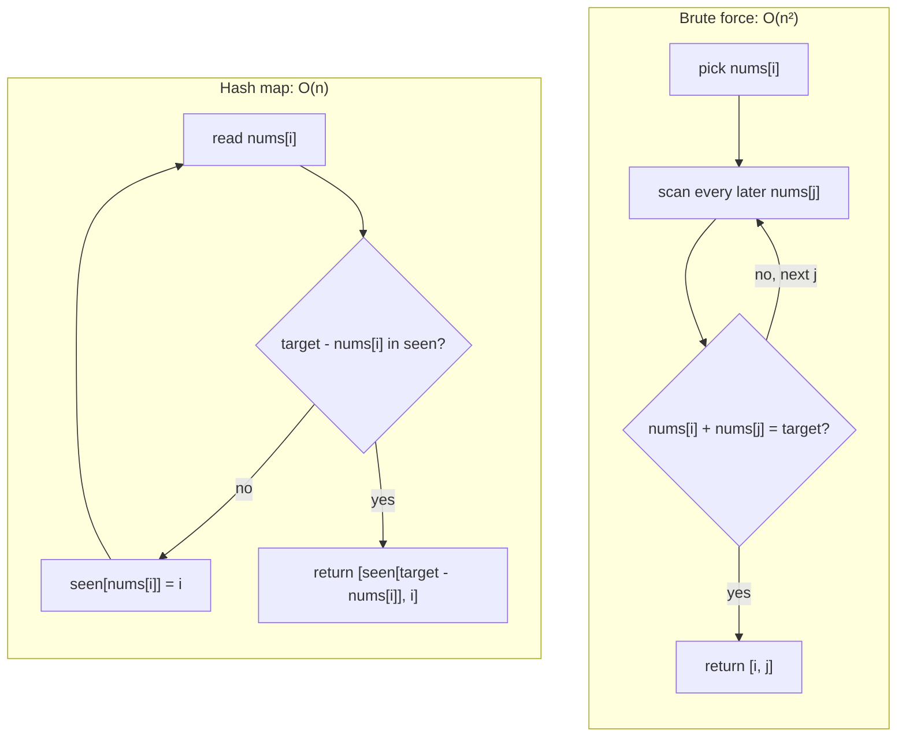
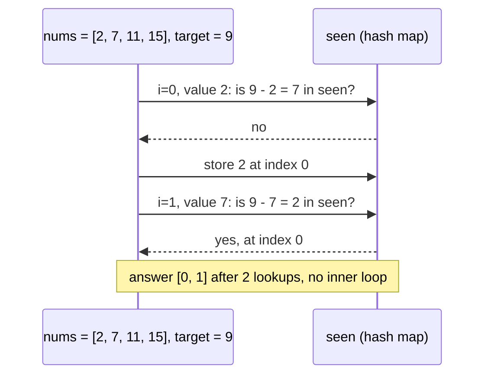

Day 1 of my 30-day DSA challenge. One problem a day, in TypeScript, about 90 minutes. I write a brute force and a
better solution myself, count the operations of both, time them, and write down what I did not measure.

## The problem in my own words

You get a list of integers `nums` and a number `target`. Find the two positions whose numbers add up to `target`
and return them as `[i, j]` with `i < j`. You cannot use the same position twice, but the same value can appear at
two positions. Numbers can be negative or zero. If no pair exists, return `null`.

That last rule came from a TypeScript complaint, not from the problem text: my first version promised
`[number, number]`, and an array with no matching pair has nothing to return. Asking "what if there is no pair?"
is also the first question I would ask an interviewer.

## Before coding: my predictions

- Brute force: O(n²), about 1,000,000 operations at n = 1,000.
- Better solution: O(n), about 1,000 operations at n = 1,000.

## Brute force

For each number, scan every number after it and check whether the two add up to the target.

```ts
for (let index = 0; index < nums.length; index++) {
  const element = nums[index];
  for (let j = index + 1; j < nums.length; j++) {
    if (target === element + nums[j]) {
      return [index, j];
    }
  }
}
return null;
```

Two nested loops, so the work grows with the square of the list length.

## The fix: remember what you have already seen

I needed a hint here (level 1: the name of the pattern, hash map). The brute force asks "which later number
completes me?" by scanning for it. A hash map answers the same question with one lookup, if I store each number
as I pass it.

```ts
const seen = new Map();
for (let index = 0; index < nums.length; index++) {
  const balance = target - nums[index];
  if (seen.has(balance)) {
    return [seen.get(balance), index];
  }
  seen.set(nums[index], index);
}
return null;
```

My first version returned `[index, seen.get(balance)]`, the wrong way round, and the tests caught it right away.



The inner loop is gone. For each number I do one lookup of `target - nums[index]`, and the price is the map, which
can hold up to n entries.

## Trace: `[2, 7, 11, 15]`, target 9



At `2` the map is empty, so I store `2 → 0`. At `7` I look up `9 - 7 = 2`, find it at index 0, and return `[0, 1]`
after two lookups.

## Measured

The benchmark puts the pair at the last two positions, so both solutions do their most work. One operation is one
pass of a loop (the brute force counts passes of both loops). The same inputs are used on every run.

| n       | brute ops     | better ops | brute ms | better ms | ops ratio |
| ------- | ------------- | ---------- | -------- | --------- | --------- |
| 1,000   | 500,499       | 1,000      | 0.500    | 0.073     | 500.5x    |
| 10,000  | 50,004,999    | 10,000     | 46.76    | 0.648     | 5,000.5x  |
| 100,000 | 5,000,049,999 | 100,000    | 11,885   | 7.48      | 50,000.5x |

Each 10x in n costs the brute force about 100x more operations and the hash map about 10x more. At 100,000
numbers the brute force took almost 12 seconds and the hash map 7 milliseconds.

My prediction for the brute force was off by a factor of two: I guessed 1,000,000 operations at n = 1,000 and got
500,499. The inner loop starts after the current position, so each pair is checked once, which gives
n(n−1)/2 = 499,500 comparisons, plus 999 for the outer loop.

## Same pattern, other problems

- **How to spot it.** The problem asks for two items that fit together, and the partner of each item can be
  computed (here `target - x`), so you can look it up instead of searching for it.
- **Other problems that use it.** Two Sum II (sorted input, so two pointers need no extra memory), 4Sum II (store
  all sums of two arrays in a map), counting pairs with a given difference (the partner is `x + k` or `x - k`). I
  have not solved these yet.
- **Where the idea is used outside interviews.** Joining two datasets on a key (a hash join in a database), and
  matching payments to refunds.

## What I did not measure

- Memory. The brute force needs a few variables (O(1)), the hash map up to n entries (O(n)), but I did not measure
  it. I only counted operations and time.
- Any case other than the worst one (the pair at the end). If the pair is near the front, both stop early.
- Timings come from one machine and one run per size. The operation counts are exact; the milliseconds are not.

## Next

Day 2: Longest Consecutive Sequence (hash set).
